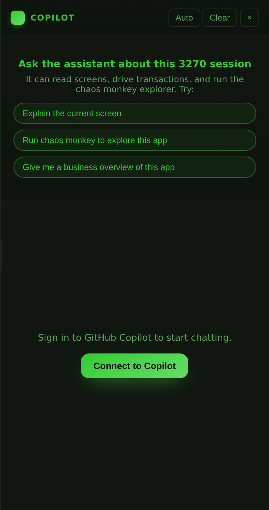

# AI Chat Mode

AI Chat mode is a side panel that lets you drive a 3270 session through conversation. You type instructions in plain language; the AI reads the current screen, fills fields, presses keys, and runs chaos exploration — all with your approval before each action.

!!! note "Driving 3270Web from outside the browser"

    The same tools are available to any MCP client — Claude Desktop, VS Code,
    Claude Code — through the [MCP Server](mcp.md). Everything on this page
    about what the assistant can do applies there too; only the front end
    differs.

You choose which AI answers. GitHub Copilot, Claude, OpenAI, Google AI,
Ollama (local or cloud) and any OpenAI-compatible endpoint are all
supported, and everything on this page works the same way whichever one
you pick. See [AI Providers](ai-providers.md) to set one up.

## Open the Panel

1. Connect to a host.
2. Click the **Open AI chat** button in the menu bar (the chat bubble icon), or press ++ctrl+k++ and run *Toggle AI chat*.
3. The side panel slides open on the right.

Drag the panel's left edge to resize it, or focus the edge and use
++left++ / ++right++ (hold ++shift++ for larger steps). The width is
remembered between sessions.

## Connect a Provider

The panel starts on **GitHub Copilot**. Before the first message you need
either a Copilot sign-in or an API key for a different provider — the
panel prompts for whichever the selected provider needs.

1. Click **Provider** in the panel header (or press ++ctrl+k++ and run
   *AI provider settings*).
2. Pick a provider, fill in whatever it asks for, and click **Save**.
3. The panel header shows the provider you are talking to, and the model
   dropdown reloads with that provider's models.

To disconnect, click **Sign out** in the panel header. For Copilot that
clears the OAuth token; for every other provider it forgets the stored
API key.

Full per-provider setup — including GitHub Enterprise, local Ollama and
corporate gateways — is in [AI Providers](ai-providers.md).

## Send a Message

Type any instruction in the input box and press **Send** (or ++enter++).

Examples:

- *"Read the current screen and tell me what options are available."*
- *"Navigate to the account inquiry menu and look up account 12345."*
- *"Run a chaos exploration and give me a summary when it finishes."*

The AI reads the current screen before acting, then proposes one tool call at a time.

## Explain This Screen

Sooner or later a screen arrives that nobody recognises — an unfamiliar
transaction, a panel four steps into a flow somebody else recorded, an
error code with no legend on it. Asking about that screen should not
require typing a sentence describing it.

**Explain this screen** does it in one click, from three places:

- **Terminal → Explain this screen** in the menu bar.
- The bulb button beside the chat input, whenever the panel is open.
- ++ctrl+k++, then *Explain this screen*.

The panel opens if it was closed, and the question is asked for you.

The screen is captured **at the moment you ask** and travels with the
question. This matters more than it sounds. The screen worth explaining is
rarely the first one, and the host is free to redraw at any time — an
inactivity timeout, a broadcast message, the next panel of a conversational
transaction. An assistant told only *"explain this screen"* reads the
display a round later and explains whatever is there by then, which is
worse than no answer: it is a confident answer about a screen you were not
asking about. Pinning the screen to the question removes that gap.

Because the screen is part of the message rather than a passing note,
follow-up questions still work — *"what is the field on line 12 for?"* is
answered against the screen you asked about, not the one now on the
display.

Two details worth knowing:

- The transcript shows your question, not the eighty columns of screen
  attached to it. The screen is there for the model; the panel stays
  readable.
- Hidden fields are masked before the screen leaves 3270Web, so a password
  typed into a sign-on panel is never sent to the AI provider and never
  written to the stored conversation. This is the same redaction the
  [REST API](rest-api.md) applies.

As with anything read from a host, the captured screen reaches the model
wrapped in `<untrusted-host-data>` tags: a screen is text somebody else
controls, and text that reads like an instruction is still data. See
[What the model sees](mcp.md#what-the-model-sees).

## Tool Approval

Each AI action requires explicit approval:

- The panel shows a **Run** button before executing any tool call.
- Click **Run** to approve it, or **Skip** to decline it.
- This prevents unintended writes or key presses.

Every tool call is a card carrying its name, arguments, result, and a
status badge. The badge and the card's left edge are colour-coded so you
can scan a long exchange quickly:

| Status | Meaning |
|---|---|
| **Pending approval** (amber) | Waiting for you to click **Run** |
| **Running** (blue) | Executing against the session |
| **Done** (green) | Completed successfully |
| **Failed** (red) | The call returned an error |
| **Skipped** (grey) | You declined it |

To let the AI proceed without pausing, enable **Auto Mode** (toggle in the panel header). In Auto Mode the panel runs tool calls automatically without waiting for you to click **Run** each time.

### What still asks in Auto Mode

Auto Mode does not mean everything runs unattended. Every tool has a class,
reported by the server alongside the tool definitions, and the class decides
how much a call can change:

| Class | Means | Examples |
|---|---|---|
| `read` | Observes. Nothing on the host or in the session is different afterwards | `get_screen`, `chaos_status`, `chaos_get_screen`, `list_skills`, `snapshot_diff` |
| `write` | Changes something a person watching can see: a field, the cursor, the screen the host shows next, a note or a hint | `write_field`, `send_key` with an ordinary key, `submit_screen`, `chaos_annotate_screen` |
| `destructive` | Ends or replaces the session, discards something held, or starts automation nobody watches step by step | `connect_session`, `chaos_start`, `chaos_resume`, `run_task`, `snapshot_delete`, `printer_stop` — and `send_key` when the key is PF3 or Clear |

Two keys are always put in front of a person: **PF3**, which commonly logs
the session off, and **Clear**, which discards what is on the screen. That
holds in Auto Mode, and it holds in every spelling the terminal accepts —
`PF3`, `pf(3)`, `F3`, `f03`.

**The server enforces it, not only the panel.** `POST /screen/key` — and
`POST /screen/submit` when it names a key — refuses one of those keys with
`409` and `"requiresApproval": true` unless the request carries
`"confirmed": true`, which the panel sends only after you click **Run**. The
model cannot set that flag; it is not part of the tool it is given. So a
script holding your session cookie, or a model that finds an unusual way to
spell a key, gets a refusal rather than a logged-off session.

`ask_user` always waits for you, in any mode.

## Choose a Model

Above the input box is a **model selector** listing the models your
selected provider offers. 3270Web asks the provider for its live catalogue
and falls back to a built-in list when it cannot (no key entered yet, or an
endpoint that has no model list). Switch at any time and the next message
uses the new model.

Each provider remembers its own model, so moving between providers does
not reset your choice — and a model name the dropdown does not list can be
typed into the **Model** box in the provider dialog.

Pick a heavier model for screen-reasoning-heavy sessions and a lighter one
for quick reads or repetitive automation.

## Available Actions

The AI can perform the following actions on your 3270 session:

| Action | Description |
|--------|-------------|
| Read screen | Returns the current screen as text with a full field map (row, col, length, value, protection flags), a label for each input field, the keyboard state, and the screen's hash |
| Send key | Presses one key and returns the screen that results. AID keys — `Enter`, `PF1`–`PF24`, `PA1`–`PA3`, `Clear` — send the screen to the host and wait for it to answer. `Tab`, `BackTab`, `Home`, the arrow keys, `EraseEOF`, `EraseInput` and `Reset` act on the terminal only |
| Write field | Types text into one unprotected field, replacing what was there |
| Submit screen | Presses `Enter`, waits for the host, and returns the screen that results |
| Wait for unlock | Waits for a host that is still processing. Needed only when a result says the keyboard is still `locked` |

### What the driving tools guarantee

The assistant works by row and column, without sight of the screen, so the
tools check what a person would see for themselves.

**Write field** looks before it types:

- The position must be inside an unprotected field. A write aimed at a label
  is refused with a message saying what is there, rather than locking the
  keyboard.
- Text longer than the room left in the field is refused whole, not typed
  until it spills.
- The field is erased from the position to its end first, so `LEE` written
  over `SMITH` leaves `LEE`, not `LEETH`. Pass `erase: false` to overtype.
- An empty string clears the field.
- The answer reports the field as it now stands. A hidden field's value comes
  back masked.
- If the terminal still rejects a keystroke — a letter in a numeric field —
  the keyboard is reset, so the next action is not refused for a reason
  unrelated to it.

Rows and columns are 0-indexed, as `get_screen` reports them. The terminal's
own status bar counts from 1, and so does a field key such as `R5C10L8`; the
server converts a field key, and the assistant is told not to convert
anything itself.

**Send key** and **Submit screen** wait for the host and return the new
screen, so the assistant sees the outcome of every action — whether the
screen changed, any message the host put up, and the keyboard state — without
a separate read. The keyboard is one of:

| State | Meaning |
|---|---|
| `unlocked` | Input is accepted |
| `locked` | The host is still processing. `wait_for_unlock` waits it out |
| `error` | The terminal rejected a keystroke and refuses everything until `Reset` is sent |

**Recording.** Start a [workflow recording](workflow.md) and what the
assistant does is recorded exactly as if you had done it: each write as a
fill step, each key as a key step. A recording of an assisted session replays
the whole of it.

## Beyond the Screen

The panel drives more of this build than the keyboard does. Each of the
following was on the [REST API](rest-api.md) before it was a tool, which meant
an assistant asked whether 3270Web could do it had no way to find out that it
could — and answered from what it *could* see, which was a keyboard and an
exploration engine.

| Ask for | Tool used | What it does |
|---|---|---|
| Run a saved task | `list_tasks` / `run_task` | Lists the [Guided Business Tasks](business-tasks.md) saved here — each with the values it needs and the answer it returns — and runs one by name. Preferred over driving the screens by hand: a task verifies it is on the screen it expects before typing |
| Check a screen against a known-good one | `snapshot_take` / `snapshot_diff` | Freezes the screen under a name, then reports which rows moved — against another snapshot or against the screen as it stands. The answer is the rows that differ, not a pass or a fail |
| Manage what is held | `snapshot_list` / `snapshot_delete` | Names and sizes of the snapshots this session holds, and how to make room |
| Describe the connection | `get_connection_details` | What was negotiated: TN3270E, the bound LU, the terminal type, TLS, byte counts. None of it is on the screen, and all of it matters when a session renders but misbehaves |
| Change what the terminal shows | `get_display_toggles` / `set_display_toggle` | Reads and writes the terminal's own display settings — monocase, crosshair, cursor blink, the underscore under input fields |
| Collect printed output | `printer_status` / `printer_start` / `printer_stop` / `printer_read_job` | Reports the [3287 printer session](printer-sessions.md) bound beside this one and every job it has collected, binds or ends one, and reads what the host printed. Batch output goes to a printer LU, never to the screen |

Snapshots live in memory for the life of the session and are never written to
disk. A long print job is cut short before it reaches the conversation; the
reply says so, and the whole file stays downloadable from the printer panel.

## Chaos Integration

The AI can run and monitor chaos exploration directly from the chat panel. This gives you the same capability as the Automation menu, but driven by conversation.

| Chat command | Tool used | What it does |
|---|---|---|
| Start exploration | `chaos_start` | Begins automated exploration with configurable step/time limits |
| Stop / Resume | `chaos_stop` / `chaos_resume` | Stops a running run or resumes a loaded one |
| Check progress | `chaos_status` | Returns current steps, transitions, unique screens, and coverage stats including the exploration frontier |
| Discovery report | `chaos_report` | Markdown report with a Mermaid flow map, per-screen working and untried keys, field discovery, and analyst hints |
| Next experiments | `chaos_insights` | Ranked guidance after a run stops: productive vs dead vs untried keys per screen, unproductive fields, and suggested experiments |
| Save hints | `chaos_save_screen_hint` / `chaos_update_hints` | Adds known transaction codes, data values, or key assignments to guide exploration |
| Export workflow | `chaos_export_workflow` | Downloads learned paths as 3270Connect-compatible JSON |

How a run is set up — which keys to block first, what to check when it
stops — is a [skill](skills.md) the assistant loads when you ask for an
exploration, not something fixed in the prompt. Whatever the skill says, two
things hold: exploration types into a live host unattended, so the assistant
is told to propose a run and agree the keys that must never be pressed before
starting one; and `chaos_start` is a destructive-class tool, so it is put in
front of you.

The Automation menu and the AI panel share the same run state — you can freely mix both. See [Chaos Mode](chaos-mode.md) for full details on the menu controls, settings, and the discovery report format, and see [Running Chaos via AI Chat](chaos-mode.md#running-chaos-via-ai-chat) for a side-by-side comparison.

## Business Understanding

Chaos exploration discovers *what works* — screens, key presses, and input values. The business-understanding tools let the AI add *what it means*: after a run (or whenever you ask it to "understand the app" or "map the business functions"), the AI reviews each discovered screen, infers its business purpose and the meaning of each input field, and records the result in the chaos mind map.

| Chat command | Tool used | What it does |
|---|---|---|
| Review discovered screens | `chaos_list_screens` | Lists every screen with previews, fields, learned values, key destinations, and existing annotations |
| Look at one screen | `chaos_get_screen` | Everything known about a single screen, by hash: purpose and notes, each field with its meaning and the values found to work, where each key leads, the keys that did nothing, and a preview |
| Annotate a screen | `chaos_annotate_screen` | Records a business purpose (e.g. *"Customer account inquiry"*) and per-field semantics (e.g. `R5C20L8` → `account_number`) |
| Catalog a business function | `business_save_function` | Saves a named multi-screen operation (steps + parameters), e.g. *"Account inquiry"* |
| List the catalog | `business_list_functions` | Returns all cataloged business functions with their parameters |
| Generate a workflow | `business_generate_workflow` | Turns a cataloged function plus parameter values into a downloadable, business-focused workflow JSON |

### Recognising the screen you are on

Every screen the assistant is shown carries a `screenHash` — the identifier
exploration files that screen under. When the screen is one exploration has
already seen, the result also carries `knownScreen`: its label, its business
purpose, what its fields mean, and which keys led somewhere from it. So what
was learned is applied to the screen in front of you rather than only listed:
the assistant knows that PF8 pages forward *here* because exploration saw it
do so, not because that is what PF8 usually does.

What is typed into the input fields does not change a screen's hash, and a
screen that differs only in a counter or a date is matched to the area
exploration folded it into.

Annotations and the function catalog are stored inside the chaos run's mind map, so they persist with [saved runs](chaos-mode.md) and travel through mind-map export/import. Knowledge is **per run**: load the annotated run (or import its mind map) in a new session to reuse it.

### Performing business functions by prompt

Once functions are cataloged you can drive them in plain language:

- *"Look up account 1234"* — the AI matches the request against the catalog and drives the live session step by step, verifying each screen before writing.
- *"Create a workflow that looks up an account"* — the AI collects any missing required parameters (via clickable questions), calls `business_generate_workflow`, and offers the resulting JSON for download. The file loads and replays through the standard [workflow](workflow.md) controls.

Generated business workflows carry `Name`, `Description`, `BusinessFunction`, and `Parameters` metadata so they are self-describing; see [Workflow](workflow.md) for the format.

## What the Model Is Sent

Each turn, the provider you chose receives the system prompt, the tool
definitions, the conversation so far, and a **session context**: where the
session stands and the screen as it was when the turn began. The context
means the assistant does not spend a round reading the screen before it can
answer.

The context has two parts, and they are kept apart. What 3270Web itself
writes — whether a host is connected, how many screens have been discovered,
the current screen's hash — may sit beside the system prompt. What came from
the host — the screen text, field values, a discovered screen's label and
purpose — is delivered as data, wrapped in `<untrusted-host-data>` tags, in
the conversation rather than in the system prompt. A host can put any words
it likes on a screen, and words in a system prompt read as instructions.

**Hidden fields are masked before anything leaves the server.** That covers
the screen text and field values in every tool result and in the session
context, the echo of a write into a hidden field, and what exploration
learned: a hidden field's working values and examples are left out of
`chaos_get_screen` and of every screen result. The assistant is told never to
ask for a password in the chat, and to ask you to type one into the terminal
yourself — anything said in the chat is sent to the provider.

What is typed into a hidden field is also kept out of the server's verbose
log.

An administrator can turn the AI chat off for the whole instance, limit which
providers may be used, and limit where a custom endpoint may point. See
[Administrator controls](ai-providers.md#administrator-controls).

## Known Limitations

- Chat requests are rate-limited per account on the server: 60 a minute by default (`RATE_LIMIT_AI`), with a separate limit on provider sign-in and settings (`RATE_LIMIT_AICONTROL`); see [Limits](multi-user.md). A single message is also stopped after 150 tool-call rounds. Your provider's own quotas apply on top.
- Tool calling is required. Every provider listed in [AI Providers](ai-providers.md) supports it, but a small local model served through an OpenAI-compatible endpoint may not, or may do it badly — if the assistant answers in prose instead of reading the screen, that is usually the cause.
- Reasoning/thinking output is not displayed. Models that think before answering still do so, but only the final answer reaches the panel.
- If the model stream fails mid-response — including a provider that closes the connection before finishing — that exchange is not added to the history and no tool call from the partial response is run. Re-send the prompt.
- Conversation history is persisted in browser localStorage and capped at the most recent 200 messages.
- Business annotations key on screen hashes, which are specific to the run's mind map. Re-running discovery against a changed application may produce new hashes; re-annotate or re-import the mind map in that case.

## Clear the Conversation

Click **Clear** in the panel header to remove all messages from the current chat session. A confirmation dialog appears before the history is deleted.

Clearing starts a new conversation, not only an empty transcript: skills the
previous conversation had loaded are sent again when the new one asks for
them. See [Skills and Extensions](skills.md#loading-and-reloading).

## Keyboard Shortcut

Press ++ctrl+k++ (++cmd+k++ on macOS) and run *Toggle AI chat* to
show or hide the panel without reaching for the menu bar; *AI provider
settings* in the same palette opens the provider dialog, and *Explain this
screen* asks about the panel in front of you without opening the chat
first. All other 3270
key bindings remain active while the panel is open; see
[Keyboard and Controls](keyboard-and-controls.md).
