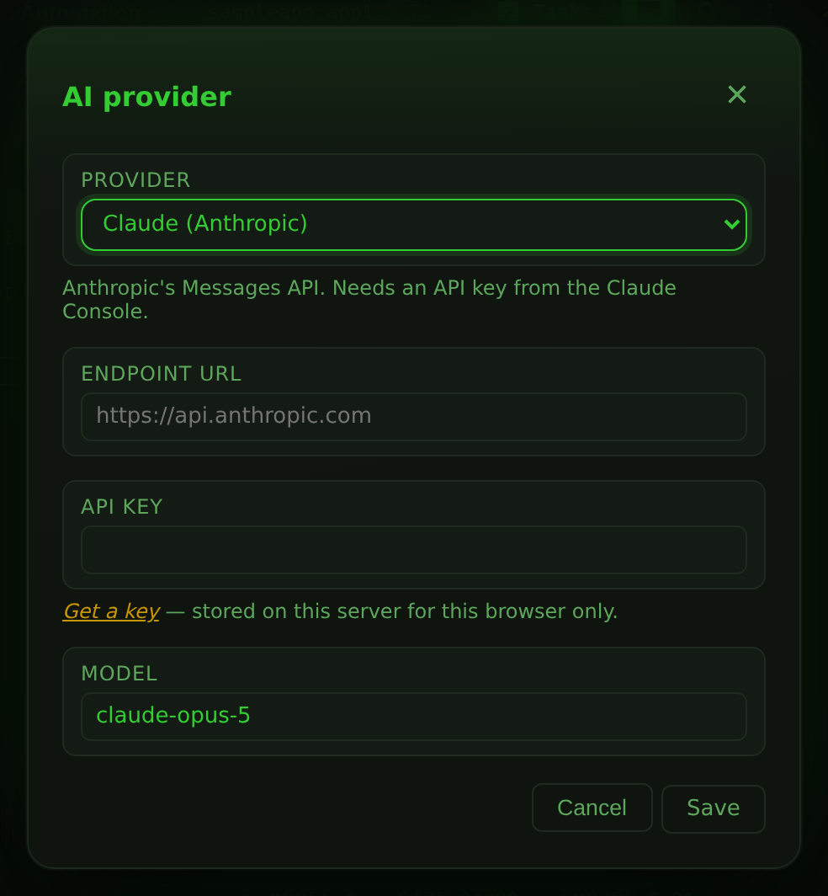

# AI Providers

[AI Chat Mode](ai-chat.md) can talk to more than one AI service. Pick the one
that matches your licensing, your data-residency rules, or your hardware —
GitHub Copilot, Claude, OpenAI, Google AI, Ollama running on your own machine,
or any endpoint that serves the OpenAI `/chat/completions` API.

Everything else about the panel is identical whichever you choose: the same
tools, the same per-call approval, the same chaos and business-understanding
workflows.

## Choose a provider

1. Open the AI chat panel and click **Provider** in its header — or press
   ++ctrl+k++ and run *AI provider settings*.
2. Choose a provider from the dropdown. The dialog reshapes itself to ask for
   what that provider needs.
3. Click **Save**.

The panel's header shows which provider you are connected to, and each reply
is labelled with it, so a conversation is never ambiguous about who answered.



## Supported providers

| Provider | Authentication | Endpoint | Notes |
|---|---|---|---|
| **GitHub Copilot** | GitHub sign-in | fixed | The default. No API key to manage. |
| **Claude (Anthropic)** | API key | `https://api.anthropic.com` | Uses the Messages API. |
| **OpenAI** | API key | `https://api.openai.com/v1` | |
| **Google AI (Gemini)** | API key | `https://generativelanguage.googleapis.com/v1beta/openai` | Gemini's OpenAI-compatible endpoint. |
| **Ollama (local)** | usually none | `http://localhost:11434/v1` | A model on your machine or LAN. |
| **Ollama Cloud** | API key | `https://ollama.com/v1` | Ollama's hosted models. |
| **OpenAI-compatible endpoint** | optional key | you supply it | vLLM, LM Studio, OpenRouter, Groq, a corporate gateway. |

### GitHub Copilot

Select **GitHub Copilot** and click **Sign in with GitHub**. A dialog opens
with a verification link and a one-time code:

1. Use **Copy** to grab the code.
2. Open the link, enter the code, and approve the access request.
3. Leave the dialog open and return to 3270Web — it polls automatically and
   signs you in once you approve.

Models come from your Copilot plan, so what appears in the dropdown depends on
your GitHub account.

#### GitHub Enterprise

GitHub Enterprise is supported, but there is no button for it in the UI. Point
3270Web at your instance by calling the REST endpoint **before** signing in:

```bash
curl -X POST http://localhost:3270/api/copilot/enterprise \
  -H 'Content-Type: application/json' \
  -d '{"url":"ghe.example.com"}'
```

The value must be a bare hostname (optionally with a port) — for example
`ghe.example.com`, not `https://ghe.example.com/`. Pass an empty string to
clear it and go back to github.com.

### Claude, OpenAI, Google AI and Ollama Cloud

These four need an API key and nothing else. Select the provider, paste the key
into **API key**, and save. The dialog links to the page where each vendor
issues keys.

Leave **Endpoint URL** alone unless you are routing through a proxy or a
regional endpoint.

### Ollama (local)

Ollama needs no key. Install it, pull a model that supports tool calling, and
make sure it is serving:

```bash
ollama pull qwen3
ollama serve
```

Then select **Ollama (local)** and save. The default endpoint is
`http://localhost:11434/v1`.

!!! note "Where 'localhost' points"
    The endpoint is called by the **3270Web server**, not by your browser. If
    you run 3270Web in Docker and Ollama on the host, `localhost` inside the
    container is the container itself — use `http://host.docker.internal:11434/v1`
    (or the host's LAN address) instead.

Ollama on another machine works the same way: give it that machine's address,
and start Ollama with `OLLAMA_HOST=0.0.0.0` so it accepts remote connections.

### OpenAI-compatible endpoint

Use this for anything that serves `/chat/completions` in the OpenAI shape.
Fill in **Endpoint URL** with the directory containing `chat/completions` —
for most servers that means including the `/v1` suffix:

| Service | Endpoint URL |
|---|---|
| vLLM | `http://your-host:8000/v1` |
| LM Studio | `http://localhost:1234/v1` |
| OpenRouter | `https://openrouter.ai/api/v1` |
| Groq | `https://api.groq.com/openai/v1` |

Add an API key if the endpoint requires one, and type the model name into
**Model** — 3270Web asks the endpoint for its model list, but a server that
does not implement `/models` needs the name entering by hand.

## Models

The model dropdown sits above the input box. 3270Web asks the selected provider
for its live catalogue each time you open the panel; when that call cannot be
made — no key entered yet, or an endpoint with no `/models` route — it falls
back to a short built-in list so the dropdown is never empty.

Each provider keeps its own model, so switching provider and back does not
reset your choice.

!!! warning "Tool calling is required"
    The assistant works by calling tools (`get_screen`, `send_key`,
    `write_field`, the chaos and business tools). Every hosted model listed
    above supports that. Small local models often do not, or do it unreliably
    — if the assistant describes what it *would* do instead of reading the
    screen, pick a model advertised as supporting tools.

## Where credentials are stored

API keys and the Copilot OAuth token are stored **on the 3270Web server**, in
the per-user configuration directory (`$XDG_CONFIG_HOME/3270Web` on Linux, the
OS user-config directory elsewhere), in files readable only by the account
running 3270Web.

They are scoped to one browser *and*, where the instance has accounts, to the
account signed in to it. A long-lived cookie identifies the browser; with
[`AUTH_MODE`](multi-user.md) set, the signed-in account is mixed in, so each
combination gets its own settings file. Keys are never sent back to the
browser; the settings dialog can only tell you *that* a key is saved, not what
it is.

The account half matters most on a device more than one person uses. The
browser cookie lasts a year and signing out of 3270Web does not touch it, so
without this the next person to sign in on a shared phone, tablet or kiosk
inherited whatever the previous one left behind — a Copilot login, an API key,
and the chat transcript filed against it. Now the stored settings change with
the account, so there is nothing to inherit. The AI chat transcript in the
browser is filed by account for the same reason.

On an instance with a single operator (`AUTH_MODE` unset) nothing changes:
there is nobody to be kept apart from, and existing sign-ins carry over.

To remove a stored credential, click **Sign out** in the panel header, or
reopen the provider dialog and save an empty key.

!!! note "Anyone with your browser session can spend your key"
    Chat requests are proxied by the server using the stored key, so anyone who
    can reach 3270Web as you can send requests that bill to your account. Treat
    a 3270Web instance the way you would treat any tool you have signed into.

## Endpoint restrictions

Custom endpoint URLs must be plain `http://` or `https://` origins. 3270Web
rejects URLs carrying credentials, a query string or a fragment.

Where the URL *points* is checked as well — when it is saved, again before
every request, and at the moment the connection is made. A hostname is not an
address, and a name can resolve wherever its owner likes. Link-local addresses
(`169.254.0.0/16`, `fe80::/10`) are always refused, which is where cloud
instance-metadata services live. A hostname resolving to one of those is
refused just as a literal is.

**Private and loopback addresses depend on who can choose an endpoint.**

- With no sign-in (`AUTH_MODE` unset or `none`) they are allowed. There is
  one operator, the machine is theirs, and a model running on it is the
  ordinary case: local Ollama works with nothing configured.
- With accounts (`AUTH_MODE=local` or `oidc`) they are refused. The person
  choosing an endpoint is no longer the person who runs the network the
  server sits in, and an endpoint on a private address is a request the
  server makes inside that network for whoever asked. An administrator who
  wants a shared instance to use a model on the LAN sets
  `AI_ALLOW_PRIVATE_ENDPOINTS=true`.

Three more rules apply to every provider request:

- **A redirect off the host is not followed.** The request is carrying that
  host's API key; a redirect to somewhere else would deliver the key there.
- **The response has to be what a chat API returns.** A completion is relayed
  only once the response has declared itself an event stream, and a model
  list is read only from JSON. An endpoint that answers with a web page or a
  file is not relayed at all.
- **Errors are summarised, not relayed.** When a request fails, the browser is
  told the status the provider answered with and what that usually means;
  the detail — the address a name resolved to, the body of the response —
  goes to the server log. A provider's own error message is quoted only when
  the request went to that provider's published endpoint, not to a custom
  one.

## Administrator controls

Four environment variables decide what the AI chat may do on an instance.
They are read by the server from its environment, set where the rest of
the [configuration](configuration.md) is set, and cannot be changed from the
settings page or by the chat itself.

| Variable | Default | Effect |
|---|---|---|
| `AI_CHAT_DISABLED` | `false` | `true` turns the AI chat off for everyone. The chat, settings, model and tool routes answer `403` with `"disabled": true`; `GET /api/ai/status` still answers and reports `"disabled": true`, which is how the page knows. Signing out and forgetting a stored key keep working |
| `AI_ALLOWED_PROVIDERS` | unset (all) | Comma-separated provider ids that may be selected and used, e.g. `anthropic,ollama`. The ids are the ones `GET /api/ai/providers` lists: `github-copilot`, `anthropic`, `openai`, `ollama`, `openai-compatible` and the rest. A provider left out disappears from the catalogue, cannot be selected or configured, and — if someone had already selected it — stops answering, with `"providerDisabled": true` in the status |
| `AI_ALLOWED_ENDPOINT_HOSTS` | unset (any) | Comma-separated glob list of hosts a **custom** base URL may name, e.g. `*.models.example.com,gateway.example.com`. Providers' own published endpoints are governed by `AI_ALLOWED_PROVIDERS` instead. Same pattern syntax as `ALLOWED_HOSTS` |
| `AI_ALLOW_PRIVATE_ENDPOINTS` | follows `AUTH_MODE` | Whether an endpoint may be on a loopback or private address. Unset: allowed with no sign-in, refused once people sign in. `true` or `false` decides it either way |

A typical shared instance that should use one hosted provider and nothing
else:

```bash
AUTH_MODE=local
AI_ALLOWED_PROVIDERS=anthropic
```

One that should use a gateway on the corporate network:

```bash
AUTH_MODE=oidc
AI_ALLOWED_PROVIDERS=openai-compatible
AI_ALLOWED_ENDPOINT_HOSTS=llm-gateway.corp.example.com
AI_ALLOW_PRIVATE_ENDPOINTS=true
```

These are in addition to the rate limits (`RATE_LIMIT_AI`,
`RATE_LIMIT_AICONTROL`) described under [Limits](multi-user.md).

## GitHub Enterprise

Setting or changing the GitHub Enterprise host signs you out of Copilot. The
sign-in was issued by the host that was configured at the time, and it is not
sent to a different one; sign in again against the new host. The API endpoint
GitHub names when it issues a Copilot token is accepted only over HTTPS and
only on GitHub's Copilot domain or the enterprise host you configured.

## Cost

With Claude selected, the system prompt, the tool definitions and the
conversation so far are marked for prompt caching. An assistant turn is often
many requests — one per tool call — each resending everything before it;
with caching, the repeated part is read back at a fraction of the input price
instead of being billed in full each time. Nothing needs configuring.

!!! note "Changing the endpoint asks for the key again"
    A key is issued for the endpoint it was entered against. Saving a base URL
    on a different host clears the stored key rather than forwarding it to the
    new origin — send a key in the same save if it belongs there. Changing the
    path on the same host, or the model, leaves the key alone.

## REST API

The provider layer is scriptable; see [REST API](rest-api.md#ai-provider) for
the full endpoint reference. In brief:

```bash
# What can I choose, and what is chosen now?
curl http://localhost:3270/api/ai/providers

# Select Claude and store a key
curl -X POST http://localhost:3270/api/ai/config \
  -H 'Content-Type: application/json' \
  -d '{"provider":"anthropic","apiKey":"sk-ant-...","model":"claude-opus-5"}'

# Is it ready to answer?
curl http://localhost:3270/api/ai/status
```

## Troubleshooting

| Symptom | Cause and fix |
|---|---|
| *"… needs an API key"* | No key saved for the selected provider. Open **Provider** and add one. |
| *"… rejected the credentials"* | The key is wrong, expired, or belongs to a different org. Re-paste it. |
| *"Could not reach … at its configured endpoint"* | The endpoint URL is wrong or the server is not running. For Docker, see the `localhost` note above. The server log has the underlying error |
| *"The AI chat is turned off on this instance"* | An administrator has set `AI_CHAT_DISABLED`. |
| *"… is not one of the AI providers this instance permits"* | The provider is not in `AI_ALLOWED_PROVIDERS`. Choose another, or ask an administrator. |
| *"This instance will not call …"* | The endpoint is on a loopback or private address and the instance has sign-in turned on, or its host is not in `AI_ALLOWED_ENDPOINT_HOSTS`. See [Administrator controls](#administrator-controls). |
| *"The endpoint did not answer like a chat API"* | The base URL points at something that is not a chat completions API — often a missing `/v1`. |
| Signed out of Copilot after changing the Enterprise host | Expected: a sign-in belongs to the host that issued it. Sign in again. |
| *"The selected model … is not available"* | Your account or endpoint does not serve that model. Pick another from the dropdown. |
| Model dropdown shows only a few generic names | The live `/models` call failed, so the built-in fallback list is showing. Check the key and endpoint; you can still type an exact model name into the provider dialog. |
| Assistant replies in prose and never reads the screen | The model is not calling tools. Switch to a model that supports tool calling. |
